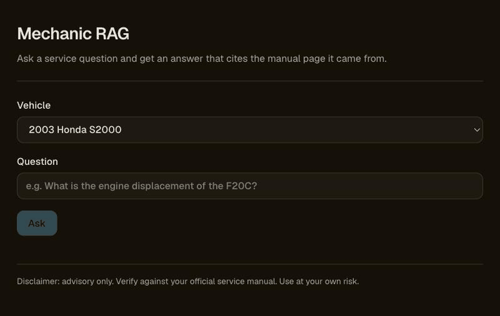
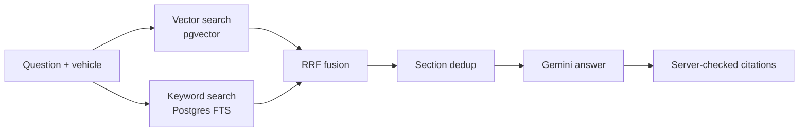

# Mechanic RAG

[](https://github.com/Alpha-W0lf/mechanic_rag/actions/workflows/ci.yml)
[](LICENSE)

Ask a question about a car and get an answer that cites the exact manual and page it came from.

**Live demo:** [mechanic-rag.vercel.app](https://mechanic-rag.vercel.app) answers from the complete Honda S2000 service manual, owner's manual and wiring diagrams. No install, no API key.



## The problem

Service manuals bury torque specs, fluids and procedures across thousands of pages. Owners and techs still dig by hand. Mechanic RAG answers from the manual itself and cites the document and page for every source it uses.

## How it works



Every search is filtered to one vehicle. Vague questions such as *how big is the engine?* get a small rule-based query expansion (adds "displacement / bore / stroke" to retrieval only), so the answer cites the spec table instead of body dimensions. Full contract: [`docs/ARCHITECTURE.md`](docs/ARCHITECTURE.md).

## Key engineering decisions

- **Hybrid retrieval with server-checked citations.** Each question runs two independent searches: vector (pgvector) and keyword (Postgres full-text). Reciprocal Rank Fusion (RRF) merges the two lists, and a section-dedup step pushes repeat chunks from the same manual section down so the answer draws on more of the manual. The server numbers every source, drops any citation the model invents, and returns document and page for each one.
- **Production hardening on a $0 stack.** Vercel + Supabase + Gemini free tiers, with retry and backoff on the model, a fallback that returns short page citations when generation fails, a per-IP and global rate limit, a locked-down database API, three health checks, an external keep-alive so the free-tier database never idles, and a daily cited-answer monitor. [Operations](docs/ops.md) covers each one.
- **Paired evals decide the ranking.** A golden set of 40 answerable questions (plus 4 with no answer in the fixture by design) scores fusion against fusion + a cross-encoder reranker on the same questions. The reranker added about 1 point of MRR and adds latency to every question, so the hosted demo runs without it; the local stack keeps it. [Decision record](evals/RERANKER_DECISION.md).

## Eval results

40 answerable hand-written questions on the synthetic S2000 fixture (plus 4 with no answer in the fixture by design), including 14 look-alike "trap" questions. Metrics below are over the 40 answerable questions. Run 2026-09-24, local generator `gemma4:e2b`, reranker `Xenova/ms-marco-MiniLM-L-6-v2`. Evidence: [`evals/evidence/2026-09-24_rrf_vs_ce_paired.md`](evals/evidence/2026-09-24_rrf_vs_ce_paired.md).

| Metric | Fusion | Fusion + reranker |
|---|---|---|
| Citation hits (cited chunk matches gold) | 39 / 40 | 39 / 40 |
| MRR (gold chunk rank) | 0.908 | 0.921 |
| Recall@1 | 0.825 | 0.850 |
| Recall@3 | 1.000 | 1.000 |

Fusion alone puts the gold chunk in its shortlist for all 40 questions. The reranker puts the right chunk first more often, at the cost of added latency. Why the hosted demo runs without it: [`evals/RERANKER_DECISION.md`](evals/RERANKER_DECISION.md).

## Try it in 60 seconds

Open the [live demo](https://mechanic-rag.vercel.app), pick **2003 Honda S2000**, and ask something like *What fluid does the rear differential use?*

Or call the API:

```bash
curl -sS -X POST "https://mechanic-rag.vercel.app/api/ask" \
  -H "content-type: application/json" \
  -d '{"vehicle_id":"cat:2003-honda-s2000","question":"What is the engine displacement of the F20C?"}'
```

You get `outcome: "answered"`, the answer text with `[1]`-style markers, and a `citations` array with `document_id`, `page_start` and `page_end` for each source the answer cites.

## Run it locally

The public clone runs on a synthetic S2000 fixture. You need Docker, Node 22, Python 3.11+ and [Ollama](https://ollama.com).

```bash
ollama pull nomic-embed-text && ollama pull gemma4:e2b
./scripts/smoke.sh   # Postgres in Docker, env file, fixture ingest, public-corpus check
cd web && pnpm install && pnpm dev
```

Then open `localhost:3000`, pick **Honda S2000 (synthetic demo)** and ask a question. Step-by-step guide and a Dev Container option: [`GETTING_STARTED.md`](GETTING_STARTED.md).

| | Live demo | Local clone |
|---|---|---|
| App | Vercel, Next.js (`web/`) | `pnpm dev` |
| Database | Supabase Postgres + pgvector | Docker Postgres + pgvector (port 5433) |
| Corpus | Full Honda S2000 manuals | Synthetic S2000 fixture |
| Generator | Gemini API `gemma-4-26b-a4b-it` | Ollama `gemma4:e2b` |
| Embeddings | `gemini-embedding-001` (768-d) | Ollama `nomic-embed-text` (768-d) |
| Ranking | Hybrid → RRF → section dedup | Same, plus MiniLM reranker |

## Quality gates

CI runs on every PR and every push to `main`: ESLint with zero warnings, TypeScript checks, 270+ automated tests (Vitest and pytest), a production build, a check that keeps PDFs and private corpora out of `fixtures/`, and a check that keeps PDFs out of the whole tree and images to `docs/assets/`. A separate health check runs on every push to `main` and on demand: it sends one question to the live demo and fails if it gets no cited answer. See [`docs/ops.md`](docs/ops.md#ci-this-repo) for what each gate proves.

## How this was built

AI-native: coding agents work from [`AGENTS.md`](AGENTS.md) and written specs with evidence tables, test plans and rollback steps (example: [soft query expansion](docs/design/soft_query_expansion.md)). Every change goes through CI, and each eval run records the date, model IDs and the git SHA it ran on. This public repo is a snapshot of the development history, so those SHAs point to pre-release commits.

## Repo map and deeper docs

- `web/` Next.js app and Ask API (`src/server/ask.ts` is the pipeline)
- `mecharag/` Python CLI: ingest and eval
- `evals/` golden set, results and evidence
- `db/migrations/` database schema
- `docs/` architecture, operations, design records
- [`FAQ.md`](FAQ.md) technical questions, including eval and model choices

---

Built by Thomas Chacko, Senior AI Engineer (Ex-Meta). Building citation-backed RAG for a real domain? [LinkedIn](https://www.linkedin.com/in/tchacko1/).

PolyForm Noncommercial 1.0.0 (source-available). Advisory only: verify against your official service manual. No OEM PDFs are redistributed.
